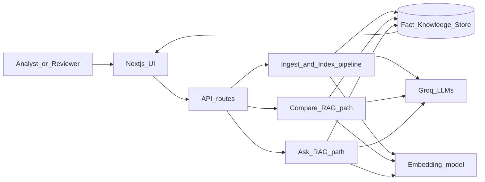
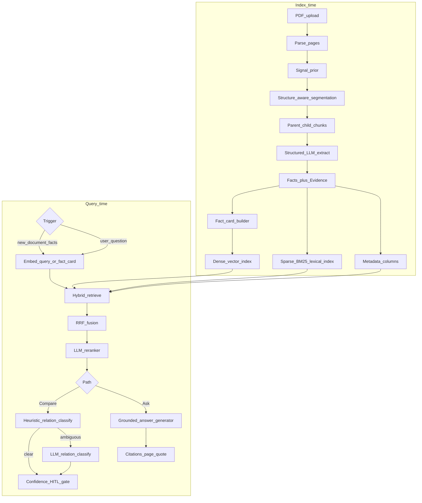
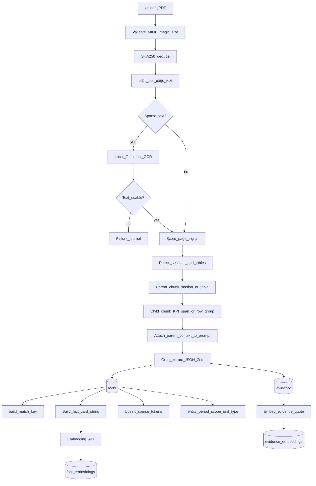
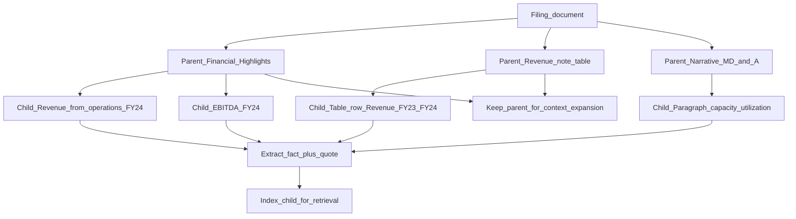
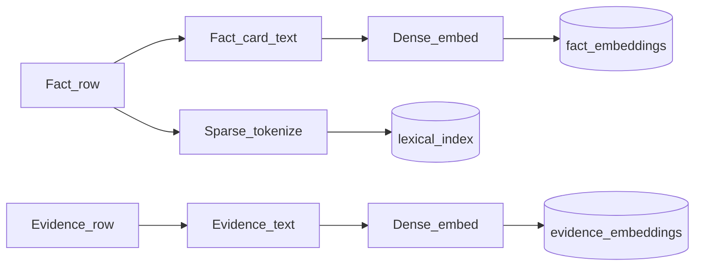
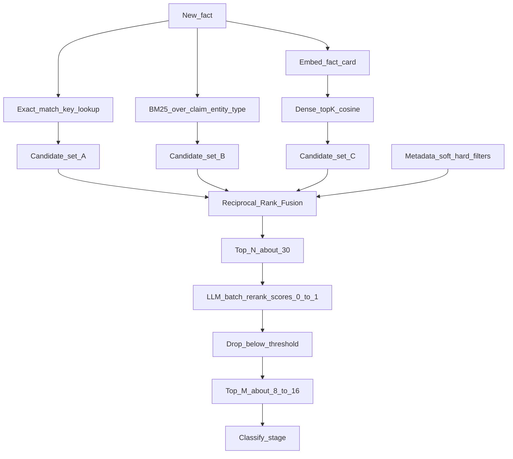
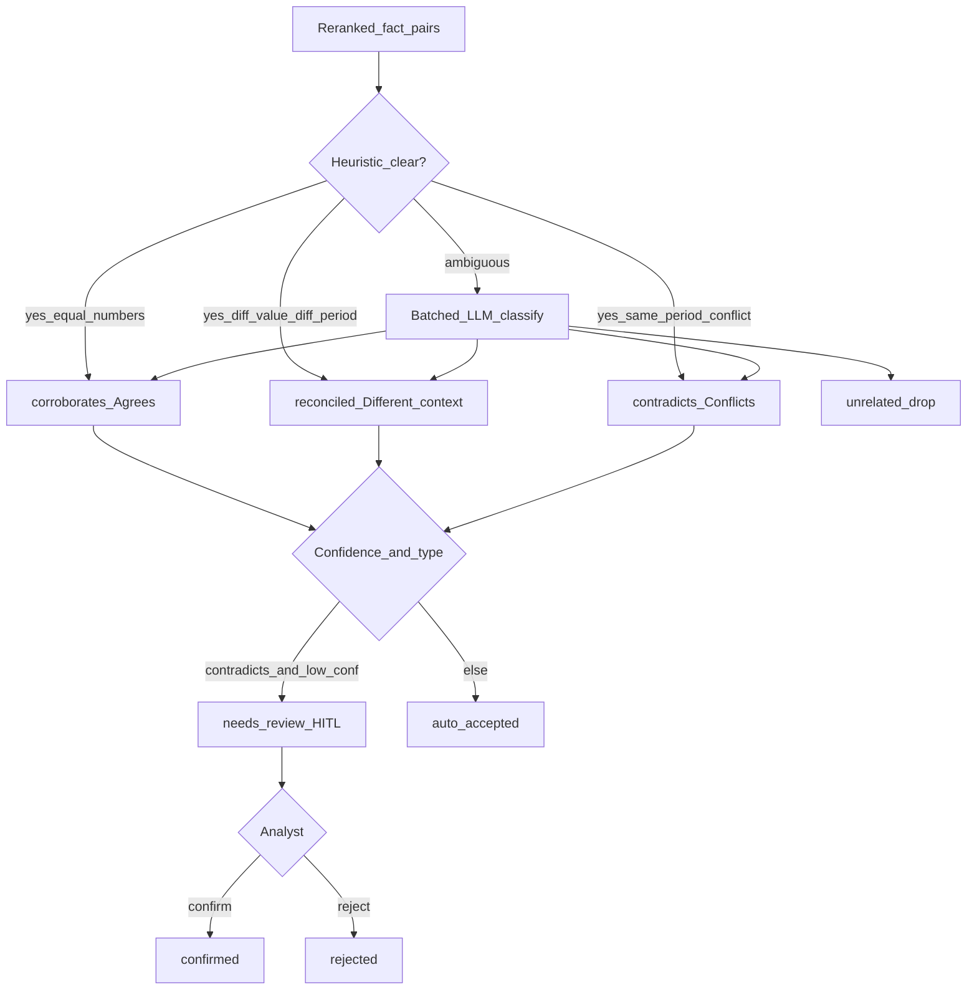
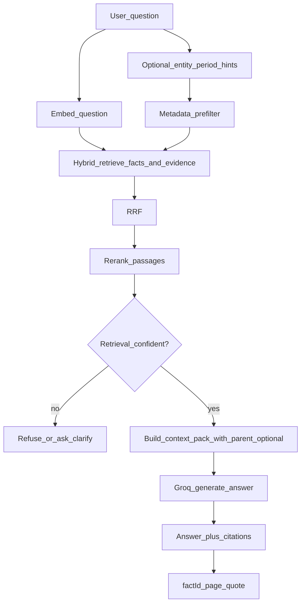
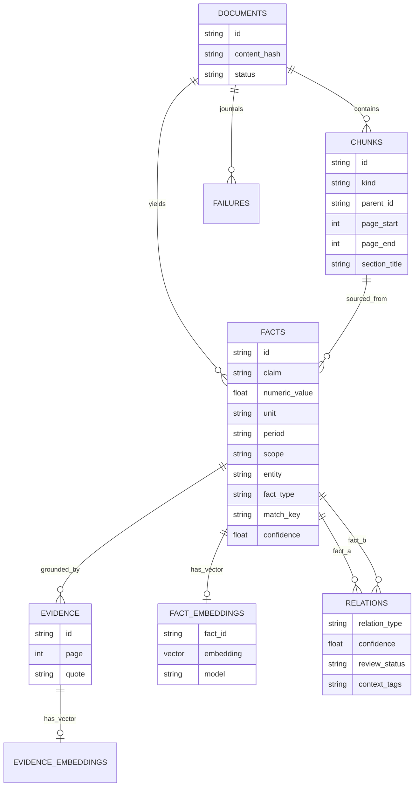
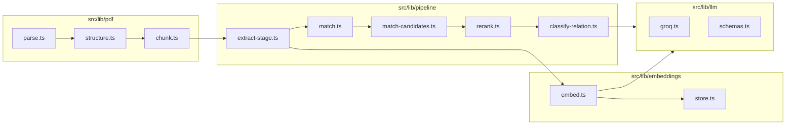

# Classical Hybrid RAG — System Architecture

Architecture label: **Classical Hybrid RAG** on a grounded fact knowledge layer.

- **Classical:** retrieve → rerank → generate / classify (no agent loops)
- **Hybrid:** lexical / `match_key` / BM25 **+** dense embeddings, fused with RRF
- **Extras:** parent–child chunking, modular stages, HITL on low-confidence conflicts
- **Not:** GraphRAG, Agentic / Self / Corrective RAG, HyDE, Adaptive, Multimodal RAG

Runtime wiring: [ARCHITECTURE.md](ARCHITECTURE.md).

---

## 1. System context



| Surface | Job |
|---------|-----|
| **Facts** | Browse grounded claims + evidence |
| **Compare** | Cross-doc Agrees / Conflicts / Different context |
| **Ask** | Question → hybrid retrieve → rerank → cited answer |
| **Issues** | Pipeline failures + HITL review queue |

---

## 2. End-to-end RAG architecture

Two loops share one index:

1. **Index-time (ingest):** PDF → structure chunks → extract facts → embed → hybrid index  
2. **Query-time:** Compare (new facts vs corpus) or Ask (natural language)



---

## 3. Ingest & indexing pipeline



### Stage responsibilities

| Stage | Input | Output | Notes |
|-------|--------|--------|-------|
| Validate / dedupe | File bytes | Stored doc or skip | Content-hash idempotency |
| Parse | PDF | Page texts | pdf.js text layer first |
| Local OCR | Sparse pages | OCR text | Tesseract.js + canvas; no LLM tokens; journal only if still empty |
| Signal prior | Pages | Priority set | Prefer KPI-dense pages; drop TOC |
| Structure segment | Pages | Sections / tables | Boundaries from layout, not token windows |
| Parent–child | Sections | Parent + children | Extract on child; parent as context |
| Extract | Child + parent ctx | Facts + evidence | Cheaper extract model; Zod + repair |
| Fact card | Fact row | Canonical string | See §5 |
| Embed | Fact card / quote | Vectors | Versioned `embedding_model` |
| Sparse index | Tokens from claim/entity/type | BM25 / lexical posting | Complements dense |
| Metadata | Structured fields | Filterable columns | Used at retrieve time |

---

## 4. Parent–child chunking



| Chunk | Typical size | Indexed? | Role |
|-------|--------------|----------|------|
| **Parent** | Section / table (~1–2k tokens) | Optional | Context for extract + Ask expansion |
| **Child** | KPI span / row group (~200–800 tokens) | **Yes** | Embed, BM25, cite, extract target |

Table children keep **row label + period columns + values** together so period/scope are not lost.

---

## 5. Embedding strategy

### Fact card template (Compare / matching)

```text
entity | fact_type | claim | raw_value | unit | period | scope
```

Example:

```text
delhivery | revenue | Revenue from operations | 8143 | crore | FY24 | consolidated
```

### Evidence template (Ask)

```text
page={n} | {verbatim_quote}
```

### Dual index



| Decision | Choice |
|----------|--------|
| Spaces | Same embedding model for index + query |
| Similarity | Cosine on L2-normalized vectors |
| Versioning | Store `embedding_model` + dim; re-embed on bump |
| Filters | SQL/metadata filters **plus** text baked into card |

---

## 6. Hybrid retrieval + RRF (Compare path)

When a new document’s facts are ready, each new fact retrieves candidates from **other documents only**.



**RRF:** for each candidate id,  
`score = Σ 1 / (k + rank_in_list_i)` across match_key / BM25 / dense lists, then sort.

**Metadata:** prefer same entity family; do **not** hard-drop different periods (needed for `reconciled`). Period stays out of `match_key` by design.

---

## 7. Rerank → classify → HITL (Compare)



| Relation | UI label | Meaning |
|----------|----------|---------|
| `corroborates` | Agrees | Same underlying claim |
| `contradicts` | Conflicts | Genuine conflict given context |
| `reconciled` | Different context | Explained by time / scope / units |
| `unrelated` | — | Not stored |

Heuristics short-circuit clear numeric/period cases; LLM only sees post-rerank ambiguous pairs.

---

## 8. Ask path (classical grounded generation)



Rules:

- Answer **only** from retrieved evidence  
- Every claim in the answer maps to a citation  
- Low retrieval confidence → refuse (no hallucination path)

---

## 9. Logical data model



---

## 10. Module map



---

## 11. Interview one-liner

> “This is a **classical hybrid RAG** over a fact ledger: structure-aware parent–child indexing, dual embeddings (fact cards + evidence), hybrid sparse+dense retrieval with RRF, LLM reranking, then either three-way relation classification or citation-grounded Ask — not GraphRAG and not agentic RAG.”

Related: [ARCHITECTURE.md](ARCHITECTURE.md) · [SCALABILITY.md](SCALABILITY.md) · [DEMO_CASES.md](DEMO_CASES.md) · [API.md](API.md)
