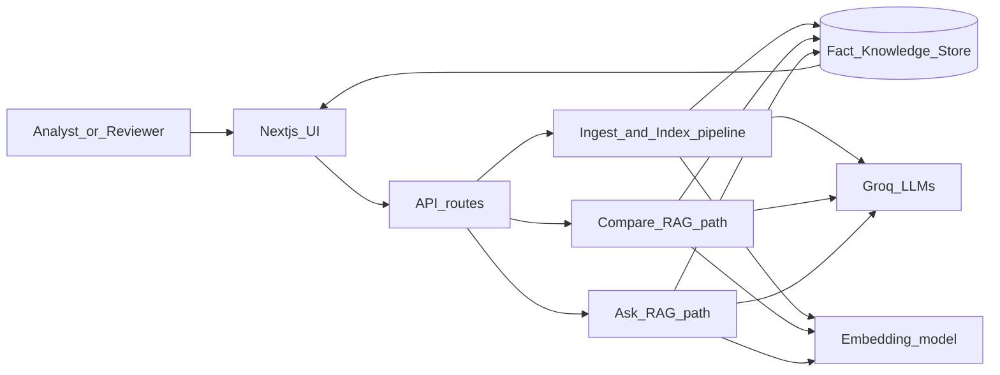
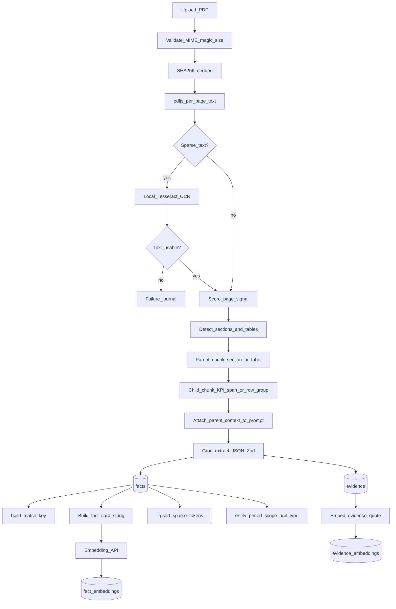
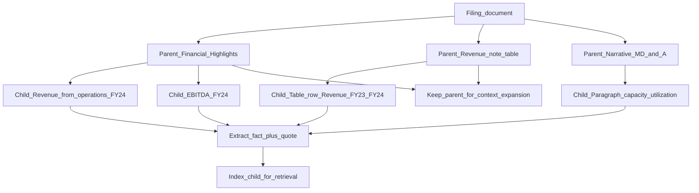
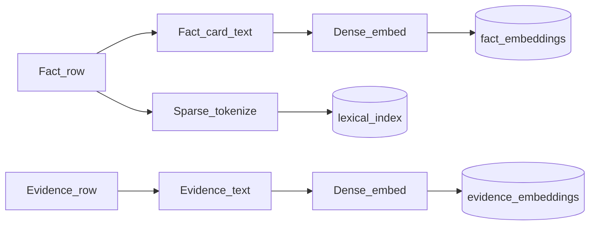
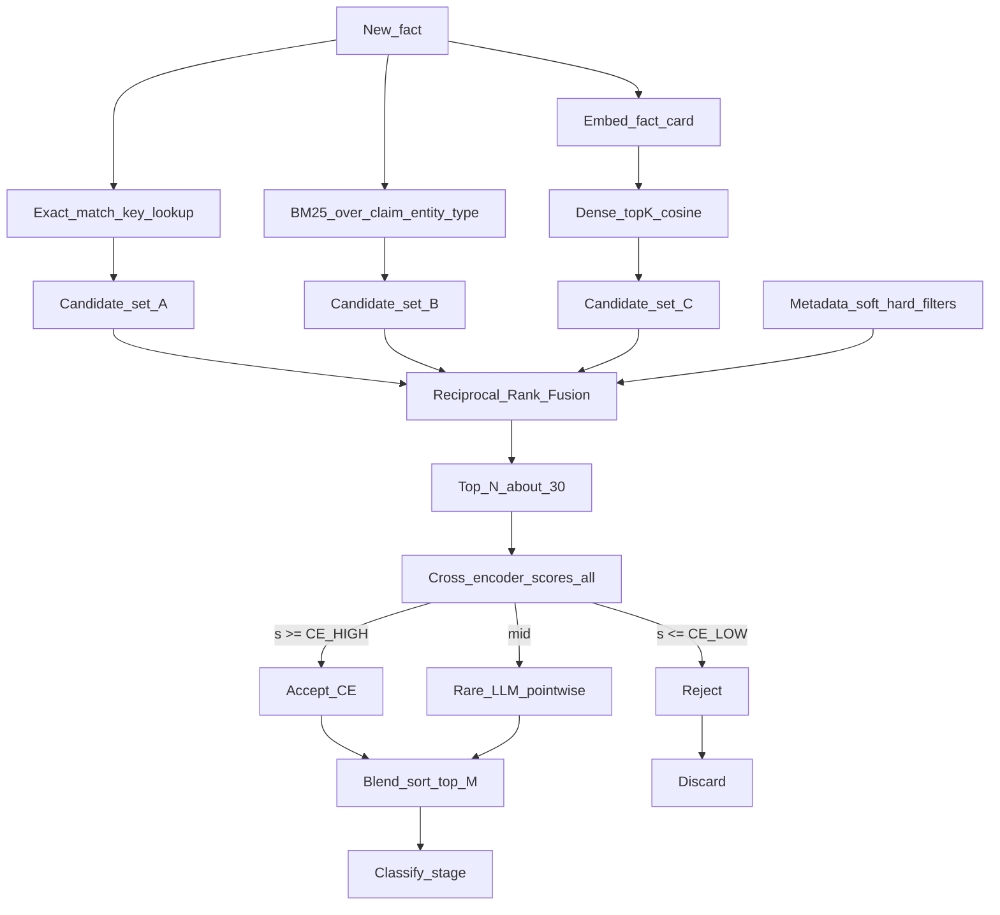
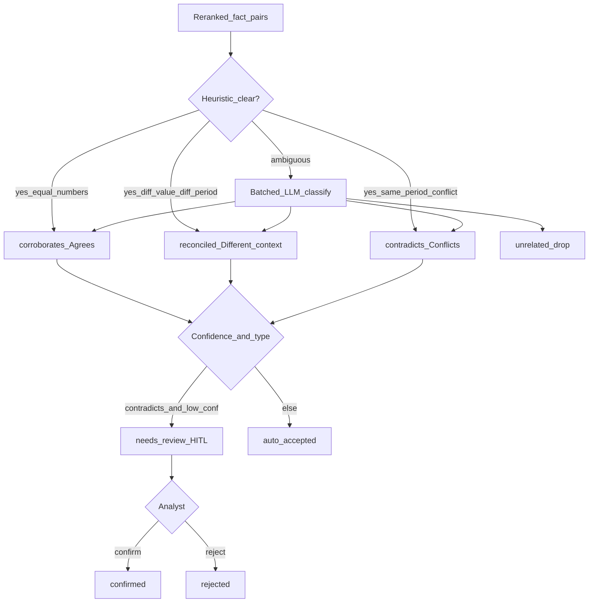
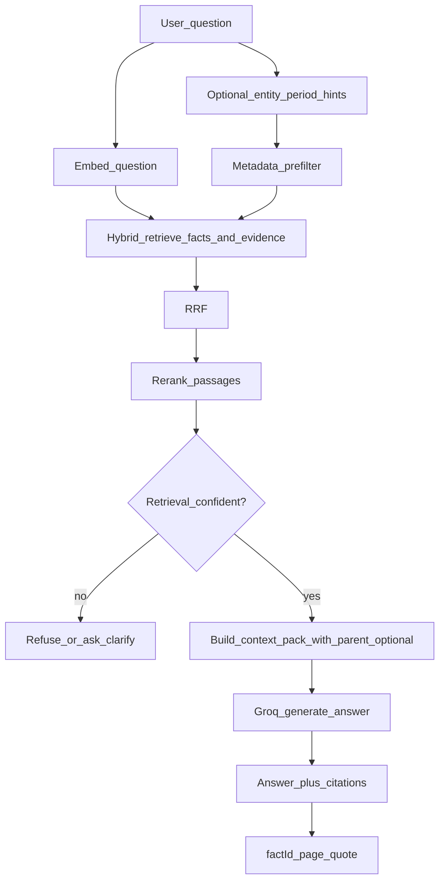
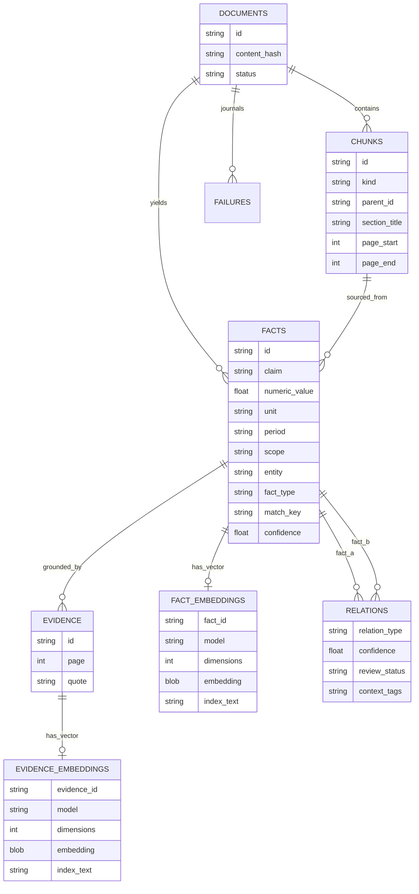
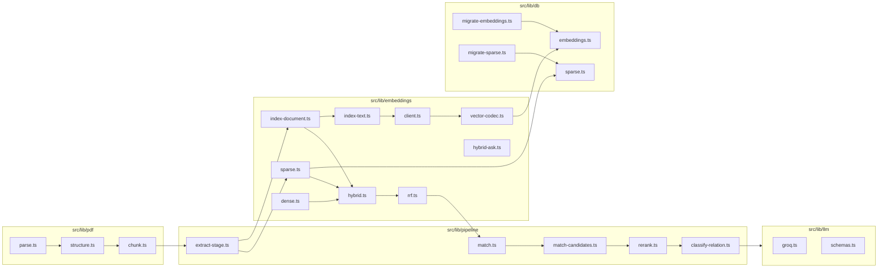

# Classical Hybrid RAG — System Architecture

Architecture label: **Classical Hybrid RAG** on a grounded fact knowledge layer.

- **Classical:** retrieve → rerank → generate / classify (no agent loops)
- **Hybrid:** lexical / `match_key` / BM25 **+** dense embeddings, fused with RRF
- **Extras:** parent–child chunking, modular stages, HITL on low-confidence conflicts
- **Not:** GraphRAG, Agentic / Self / Corrective RAG, HyDE, Adaptive, Multimodal RAG

Runtime wiring: [ARCHITECTURE.md](ARCHITECTURE.md).

---

## 1. System context



| Surface | Job |
|---------|-----|
| **Facts** | Browse grounded claims + evidence |
| **Compare** | Cross-doc Agrees / Conflicts / Different context |
| **Ask** | Question → hybrid retrieve → rerank → cited answer |
| **Issues** | Pipeline failures + HITL review queue |

---

## 2. End-to-end RAG architecture

Two loops share one index:

1. **Index-time (ingest):** PDF → structure chunks → extract facts → embed → hybrid index  
2. **Query-time:** Compare (new facts vs corpus) or Ask (natural language)


---

## 3. Ingest & indexing pipeline



### Stage responsibilities

| Stage | Input | Output | Notes |
|-------|--------|--------|-------|
| Validate / dedupe | File bytes | Stored doc or skip | Content-hash idempotency |
| Parse | PDF | Page texts | pdf.js text layer first |
| Local OCR | Sparse pages | OCR text | Tesseract.js + canvas; no LLM tokens; journal only if still empty |
| Signal prior | Pages with text | `signalScore` per page | KPI/finance density via [`signal.ts`](../src/lib/pdf/signal.ts); TOC/glossary penalized; selects extract budget |
| Structure segment | High-signal pages | `DocumentSection[]` | Heading heuristics in [`structure.ts`](../src/lib/pdf/structure.ts); inspect via job progress / `scripts/smoke-sections.ts` |
| Table blocks | Sections | `DocumentBlock` (`table` \| `narrative`) | Number/header heuristics in [`tables.ts`](../src/lib/pdf/tables.ts); inspect via `scripts/smoke-blocks.ts` |
| Hierarchy builder | Pages | parents + children | [`hierarchy.ts`](../src/lib/pdf/hierarchy.ts) — default path |
| Parent chunks | Blocks | `chunks.kind=parent` | [`parents.ts`](../src/lib/pdf/parents.ts) |
| Child chunks | Parents | `chunks.kind=child` + `parent_id` | [`children.ts`](../src/lib/pdf/children.ts); narrative packs + table header/row groups |
| Extract | Top children + parent context | Facts + evidence | [`extract.ts`](../src/lib/llm/extract.ts) + [`select-extract.ts`](../src/lib/pdf/select-extract.ts); Zod + repair |
| Fact card | Fact row | Canonical string | See §5 |
| Embed | Fact card / quote | Vectors | Versioned `embedding_model` |
| Sparse index | Fact-card tokens | `fact_sparse_postings` + BM25 | [`sparse.ts`](../src/lib/embeddings/sparse.ts) — `indexDocumentSparse` / `sparseSearch` |
| Metadata | Structured fields | Filterable columns | Used at retrieve time |

---

## 4. Parent–child chunking



| Chunk | Typical size | Indexed? | Role |
|-------|--------------|----------|------|
| **Parent** | Section / table (~1–2k tokens) | Optional | Context for extract + Ask expansion |
| **Child** | KPI span / row group (~200–800 tokens) | **Yes** | Embed, BM25, cite, extract target |

Table children keep **row label + period columns + values** together so period/scope are not lost.

---

## 5. Embedding strategy

Index text builders: [`index-text.ts`](../src/lib/embeddings/index-text.ts).  
Index-time embed after extract: [`index-document.ts`](../src/lib/embeddings/index-document.ts) (facts + evidence; skip/re-embed on model bump).  
Evidence Ask prep: sparse postings + [`hybridRetrieveEvidence`](../src/lib/embeddings/hybrid-ask.ts) → CE rerank → grounded generate (A0–A7).

### Fact card template (Compare / matching)

```text
entity | fact_type | claim | raw_value | unit | period | scope
```

Example:

```text
Delhivery Limited | revenue | Revenue from operations | 8143 | crore | FY24 | consolidated
```

### Evidence template (Ask)

```text
page={n} | {verbatim_quote}
```

### Dual index



| Decision | Choice |
|----------|--------|
| Provider | **Local free** `Xenova/all-MiniLM-L6-v2` (384-d) via `@huggingface/transformers` |
| Spaces | Same embedding model for index + query |
| Similarity | Cosine on L2-normalized vectors |
| Storage | SQLite `fact_embeddings` / `evidence_embeddings` — Float32 little-endian BLOBs ([`vector-codec.ts`](../src/lib/embeddings/vector-codec.ts)); upsert/get/list/delete in [`db/embeddings.ts`](../src/lib/db/embeddings.ts) |
| Dense recall | Brute-force cosine via [`denseSearch`](../src/lib/embeddings/dense.ts) / `denseSearchEvidence` (ANN/pgvector later) |
| Versioning | Store `model` + `dimensions`; re-embed on bump |
| Filters | SQL/metadata filters **plus** text baked into card |

---

## 6. Hybrid retrieval + RRF (Compare path)

When a new document’s facts are ready, each new fact retrieves candidates from **other documents only**.



**RRF:** for each candidate id,  
`score = Σ 1 / (k + rank_in_list_i)` across match_key / BM25 / dense lists, then sort  
([`rrf.ts`](../src/lib/embeddings/rrf.ts), default `k=60` via `RRF_K`).

**Cascade rerank:** CE (`Xenova/ms-marco-MiniLM-L-6-v2`) scores every pair; LLM only when `CE_LOW < s < CE_HIGH` (capped by `RERANK_LLM_MAX_PER_DOC`). Final mid score = `α·CE + (1-α)·LLM` (`RERANK_CE_BLEND`).

**Compare wiring:** hybrid → [`rerankFactPairs`](../src/lib/pipeline/rerank.ts) → heuristic/LLM classify.

**Metadata (soft only):** [`metadataSoftBoost`](../src/lib/embeddings/metadata-filters.ts) multiplies RRF scores for same entity family / unit / fact_type / period (`ENTITY_FAMILY_BOOST`, …). Different periods are **kept** so classify can emit `reconciled`. Period stays out of `match_key` by design.

---

## 7. Rerank → classify → HITL (Compare)



| Relation | UI label | Meaning |
|----------|----------|---------|
| `corroborates` | Agrees | Same underlying claim |
| `contradicts` | Conflicts | Genuine conflict given context |
| `reconciled` | Different context | Explained by time / scope / units |
| `unrelated` | — | Not stored |

Heuristics (stage 1) short-circuit clear cases without Groq:
- matching numbers → `corroborates`
- equal numbers + different **unit/scope** → `reconciled`
- different values + different **period/unit/scope** → `reconciled`
- same period/unit/scope + conflicting numbers → `contradicts`
- different entity family or fact type (weak rerank) → `unrelated` (dropped)
- strong rerank + odd entity/type → leave for LLM

LLM (stage 2) only sees remaining ambiguous post-rerank pairs:
- Stronger finance prompt (`CLASSIFY_SYSTEM_PROMPT`) preferring reconciled/unrelated over false conflicts
- Batched via `MATCH_BATCH_SIZE` on `GROQ_MATCH_MODEL`
- Soft parse: clamp confidence, missing indexes → null + failure journal (job continues)

---

## 8. Ask path (classical grounded generation)



Rules:

- Answer **only** from retrieved evidence  
- Every claim in the answer maps to a citation  
- Low retrieval confidence → refuse (no hallucination path)

---

## 9. Logical data model



---

## 10. Module map



---

## 11. Embeddings / hybrid pipeline checklist

| # | Stage | Status | Entry |
|---|--------|--------|--------|
| 1 | Fact card / evidence index text | done | [`index-text.ts`](../src/lib/embeddings/index-text.ts) |
| 2 | Free local MiniLM embed client | done | [`client.ts`](../src/lib/embeddings/client.ts) |
| 3 | Vector storage schema + CRUD | done | [`migrate-embeddings.ts`](../src/lib/db/migrate-embeddings.ts) |
| 4 | Index on ingest | done | [`index-document.ts`](../src/lib/embeddings/index-document.ts) |
| 5 | Sparse / BM25 | done | [`sparse.ts`](../src/lib/embeddings/sparse.ts) |
| 6 | Dense cosine search | done | [`dense.ts`](../src/lib/embeddings/dense.ts) |
| 7 | Hybrid + RRF → Compare | done | [`hybrid.ts`](../src/lib/embeddings/hybrid.ts) |
| 8 | Metadata soft filters + caps | done | [`metadata-filters.ts`](../src/lib/embeddings/metadata-filters.ts) |
| 9 | Evidence Ask prep | done | [`hybrid-ask.ts`](../src/lib/embeddings/hybrid-ask.ts) |
| 10 | Fixtures + smoke | done | [`fixtures.ts`](../src/lib/embeddings/fixtures.ts), `npm run smoke:hybrid` |

**Rerank (Compare):** cascade CE + rare LLM — implemented.  
**Out of scope:** GraphRAG / agentic RAG.

### Ask path checklist (A0–A7)

| # | Stage | Status | Entry |
|---|--------|--------|--------|
| A0 | Hybrid evidence retrieve (BM25 ∪ dense → RRF) | done | [`hybrid-ask.ts`](../src/lib/embeddings/hybrid-ask.ts) |
| A1 | Ask config + citation/answer Zod schemas | done | [`config.ts`](../src/lib/config.ts) `getAskConfig`, [`schemas.ts`](../src/lib/llm/schemas.ts) |
| A2 | Rerank evidence (CE on question↔quote) | done | [`ask-rerank.ts`](../src/lib/pipeline/ask-rerank.ts) |
| A3 | Context pack + refuse gate | done | [`ask-context.ts`](../src/lib/pipeline/ask-context.ts) |
| A4 | Grounded generate (Groq JSON + citations) | done | [`ask-generate.ts`](../src/lib/pipeline/ask-generate.ts) |
| A5 | `askQuestion` + `POST /api/ask` | done | [`ask.ts`](../src/lib/pipeline/ask.ts), [`api/ask`](../src/app/api/ask/route.ts) |
| A6 | Ask UI tab | done | [`ask-panel.tsx`](../src/components/ask-panel.tsx) |
| A7 | Fixtures + smoke | done | [`ask-fixtures.ts`](../src/lib/pipeline/ask-fixtures.ts), `npm run smoke:ask` |

### Classify / HITL checklist (C1–C6)

| # | Stage | Status | Entry |
|---|--------|--------|--------|
| C1 | Heuristics (unit/scope/entity/unrelated) | done | [`classify-relation.ts`](../src/lib/pipeline/classify-relation.ts) |
| C2 | LLM batch parse harden | done | `parseClassifyBatchResponse` / `normalizeClassificationResult` |
| C3 | `review_status` persist + gate | done | [`review-status.ts`](../src/lib/pipeline/review-status.ts) |
| C4 | Threshold / classify config | done | [`config.ts`](../src/lib/config.ts) |
| C5 | HITL API + Compare/Issues UI | done | `POST /api/relations/:id/review` |
| C6 | Golden fixtures + offline eval | done | [`classify-fixtures.ts`](../src/lib/pipeline/classify-fixtures.ts), `npm run smoke:classify` |

Smoke:

```bash
npm test
npm run smoke:hybrid     # offline hybrid recall fixture
npm run smoke:classify   # offline Agrees/Conflicts/Reconciled/Unrelated + HITL goldens
npm run smoke:ask        # offline Ask refuse/cite goldens (mocked CE + Groq)
npm run smoke:embed      # optional live MiniLM download
```

---

## 12. Interview one-liner

> “This is a **classical hybrid RAG** over a fact ledger: structure-aware parent–child indexing, dual embeddings (fact cards + evidence), hybrid sparse+dense retrieval with RRF, cascade CE rerank (rare LLM mid-band), then either three-way relation classification or citation-grounded Ask — not GraphRAG and not agentic RAG.”

Related: [ARCHITECTURE.md](ARCHITECTURE.md) · [SCALABILITY.md](SCALABILITY.md) · [DEMO_CASES.md](DEMO_CASES.md) · [API.md](API.md)
